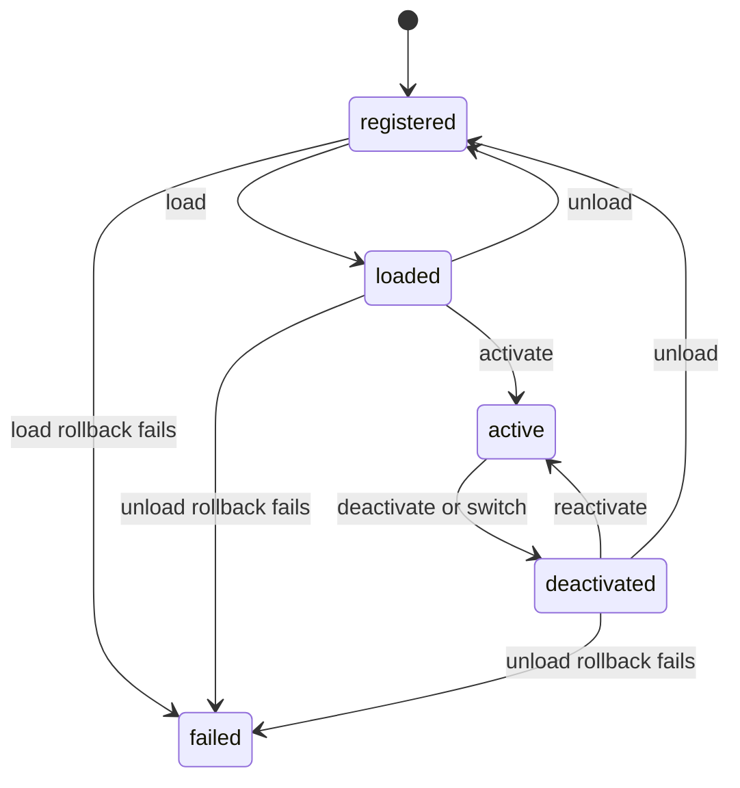

# Modules

**Document type:** Architecture specification  
**Status:** Living document  
**Scope:** Module identity, lifecycle, composition, dependencies, state, isolation, and errors.  
**Related:** `overview.md` §§6–8, `workspace.md` §§3.5, 6.4, `clinical_workflows.md`, ADR-0001, ADR-0002, ADR-0007–ADR-0012, `tools.md`, `commands.md`, `editors.md`

---

## 1. Purpose

A **Module** is a coherent functional capability of CranioZ. It groups contributions such as Commands, Services, Tools, Editors, Data Types, Flows, and UI compositions so the Application layer can load and coordinate that capability.

A Module declares its contributions; platform registries and the Workspace make them available and materialize the UI. A Module is not an architectural layer and does not own the Workspace, Areas, or Editor instances. This contract describes the built-in Module system. Plugin discovery and isolation remain future work.

## 2. Architectural role and ownership

The platform has four architectural layers: Domain, Application, Infrastructure, and UI. Modules provide capabilities across those layers through public contracts; they do not create a fifth layer or change the layer boundaries.

| Concern | Owner |
|---|---|
| Clinical concepts and invariants | Domain |
| Commands, services, tasks, flows, lifecycle coordination | Application |
| Persistence and technical adapters | Infrastructure, behind application/domain ports |
| Areas, Editors, Workspace, rendering | UI/platform |
| Contribution declarations and Module-local lifecycle | Module implementation |

A Module is not an Area, Editor, Workspace, or Flow. A Flow orchestrates work across modules; it does not replace module behavior. The Application layer chooses and loads the Module for a workflow step, then passes its `ModuleUISpec` to the Workspace. The Workspace materializes that specification without interpreting clinical workflow semantics.

## 3. Identity and manifest

### 3.1 `module_id` and version

`module_id` is lowercase, dot-separated, unique, stable, and path-safe, for example `orthognathic`, `tomography`, or `core.settings`. It is independent of the translated display name. Once released, changing it requires an explicit migration of references.

Each Module declares a semantic version (`major.minor.patch`). The Module version describes the Module implementation and compatibility; it is distinct from versions of UI layouts, workflow definitions, and persisted project data.

Display name and description are translation keys resolved by `TranslationService`.

### 3.2 Manifest

The manifest is declarative metadata for discovery, identity, and dependency resolution. The Module implementation is the single source of truth for contributions; the manifest does not repeat contribution lists.

```python
MANIFEST = ModuleManifest(
    module_id="orthognathic",
    version="1.0.0",
    label_key="modules.orthognathic.label",
    description_key="modules.orthognathic.description",
    entry_point=(
        "cranioz.modules.builtin.orthognathic.module:OrthognathicModule"
    ),
    dependencies=(
        ModuleDependency("tomography", ">=1.0.0"),
        ModuleDependency("cephalometry", ">=1.0.0,<2.0.0"),
    ),
)
```

Built-in manifests are Python values under `cranioz.modules.builtin.<module>/manifest.py`. A future plugin format may use static data, but plugin loading and security are outside this version.

The registry validates manifest structure without importing the `entry_point`: identifier and version syntax, translation-key types, dependency identifiers, and supported version constraints. Importing a Module happens only during `load()`. Cycles and installed-version compatibility are checked when resolving the requested Module's dependency graph.

Version constraints support `>=`, `>`, `<=`, `<`, `==`, and comma-separated conjunctions. An omitted constraint means any version. Optional dependencies are not supported in this version.

## 4. Lifecycle

### 4.1 States

| State | Meaning |
|---|---|
| `registered` | Manifest is known to `ModuleRegistry`; no Module instance or contributions are retained. Initial state. |
| `loaded` | Dependencies are resolved; instance and contributions are registered. |
| `active` | Application has materialized one of the Module's UI specs and completed activation. |
| `deactivated` | Its UI spec is not active; instance and registrations remain. |
| `failed` | A load/unload rollback failed; registry consistency cannot be guaranteed. Restart is required. |

After successful unload, the Module returns to `registered`: its manifest remains known, but its instance and contributions are gone. A later `load()` creates a fresh instance. `unregister()` is allowed only in `registered`.

### 4.2 Transitions and idempotency



- `load()` on `loaded`, `active`, or `deactivated` returns the existing instance. `load()` on `failed` raises `ModuleLoadFailed`.
- `unload()` on `registered` is a no-op.
- An active Module must be deactivated before unload; otherwise `ModuleInUse` is raised.
- `unregister()` on any state except `registered` raises `ModuleStillLoaded`; unknown IDs are a no-op.
- Load and unload affect one Module at a time. If loading A successfully loads B and then fails on C, B remains loaded; the caller decides whether to unload B.
- `failed` is reserved for load/unload rollback failure. Other errors restore the state that existed before the operation, except cleanup-hook and service-disposal errors after successful unregistration, which are logged while unload completes. A failed Module cannot be loaded, unloaded, or unregistered. If a failed Module has active dependents, the Application closes their activation scopes and clears the Workspace before marking those dependents failed; loaded dependents are also marked failed because their registrations may no longer be valid.

### 4.3 State after errors

| Operation/error | Result |
|---|---|
| Invalid or conflicting registration | Existing registry state is unchanged. |
| `unregister()` outside `registered` | `ModuleStillLoaded`; no state change. |
| Unknown Module | `ModuleNotFound`; no state change. |
| `load()` on `failed` | `ModuleLoadFailed`; state remains `failed`. |
| Missing/incompatible/failed dependency or reachable cycle | Requested Module remains `registered`; already loaded dependencies remain loaded. |
| Import, constructor, interface, contribution declaration, UI-spec validation, registration, or `on_load` failure | Successful partial registrations are rolled back; instance is discarded; state returns to `registered`. |
| Load rollback failure | `failed`. |
| `ModuleInUse` during unload | No state change. |
| Unregistration failure with successful rollback | Original loaded/deactivated state and same instance are restored. |
| Unload rollback failure | `failed`. |
| `on_unload()` or service-disposal error after successful unregistration | Error is logged; unload completes and state becomes `registered`. |
| Activation failure | Application restores the prior spec, or clears the Workspace if restoration fails; modules end loaded/deactivated, never `failed`. |

## 5. Dependencies

Dependencies are hard dependencies. The loader builds the subgraph reachable from the requested Module, so an unrelated cycle does not prevent loading. It detects cycles and validates every dependency's registered manifest and version before loading in topological order.

Dependencies load before their dependents and are loaded only once. Unloading a Module is refused while any loaded Module depends on it; unload does not cascade. Shared dependencies remain loaded until explicitly unloaded after their dependents.

## 6. Module interface and contributions

The loader imports the manifest entry point, constructs it with no arguments, and validates that the instance satisfies the `Module` Protocol and exposes a `manifest` structurally equal to the registered manifest. If the instance lacks `manifest`, has a mismatch, or lacks a required method, `load()` raises `ModuleLoadFailed`; `register()` remains static and does not import code. Framework services are supplied via `ModuleContext` in `on_load()`, not through the constructor. The loader owns the instance and discards it after successful unload or failed load rollback.

```python
class Module(Protocol):
    manifest: ModuleManifest

    def commands(self) -> tuple[type[Command], ...]: ...
    def services(self) -> tuple[type[Service], ...]: ...
    def tools(self) -> tuple[type[Tool], ...]: ...
    def editors(self) -> tuple[type[Editor], ...]: ...
    def data_types(self) -> tuple[type[DataType], ...]: ...
    def flows(self) -> tuple[FlowDefinition, ...]: ...
    def ui_specs(self) -> tuple[ModuleUISpec, ...]: ...
    def on_load(self, context: ModuleContext) -> None: ...
    def on_unload(self) -> None: ...
    def on_activate(self, spec: ModuleUISpec) -> None: ...
    def on_deactivate(self) -> None: ...
```

`Module` is a structural Protocol. The loader accepts any entry-point class whose instance satisfies it; explicit inheritance is not required. `ModuleBase` is an optional convenience base class implementing empty contribution methods and no-op hooks. Runtime checks, if used, validate the required attributes/methods structurally; `isinstance` checks require a runtime-checkable Protocol and are not otherwise part of this contract.

```python
class ModuleBase:
    def commands(self) -> tuple[type[Command], ...]: return ()
    def services(self) -> tuple[type[Service], ...]: return ()
    def tools(self) -> tuple[type[Tool], ...]: return ()
    def editors(self) -> tuple[type[Editor], ...]: return ()
    def data_types(self) -> tuple[type[DataType], ...]: return ()
    def flows(self) -> tuple[FlowDefinition, ...]: return ()
    def ui_specs(self) -> tuple[ModuleUISpec, ...]: return ()
    def on_load(self, context: ModuleContext) -> None: pass
    def on_unload(self) -> None: pass
    def on_activate(self, spec: ModuleUISpec) -> None: pass
    def on_deactivate(self) -> None: pass
```

Contribution methods are declarative and return classes or immutable definitions, not service instances. The loader registers Commands, Services, Tools, Editors, Data Types, and Flows in their respective registries. Command handlers remain registered through the Application's command-handler mechanism. `ui_specs()` is read by the Application; it is not a registry operation.

Registration order is Commands → Services → Tools → Editors → Data Types → Flows. The loader then reads and validates UI specs and calls `on_load()`. UI specs are not registered, so they are not included in registration/unregistration order.

### 6.1 `ModuleContext`

```python
@dataclass(frozen=True)
class ModuleContext:
    module_id: str
    correlation_id: str | None
    event_subscription: EventSubscription
    event_publisher: EventPublisher
    command_bus: CommandBus
    task_manager: TaskManager
    project_provider: Callable[[], ProjectContext | None]
    services: ServiceContainer
    telemetry: TelemetrySink
```

`project_provider()` returns the current project context; the Module must not retain a context across project open/close transitions. Where the CommandBus or telemetry implementation is unavailable, the Application supplies the documented no-op/failing adapter instead of `None`.

The `EventSubscription` instance is **stable across activations**: the Application rebinds it to a fresh scope between `on_deactivate()` and
the next `on_activate()`, rather than creating a new instance. A Module that stored `self._subscription = context.event_subscription` in
`on_load()` keeps a valid reference; subscriptions made through it always target the currently active scope.

`event_publisher` is the application-owned publication port with a `publish(event)` operation. Modules may publish only declared application events through it; state-changing events are emitted by Commands/Services after a successful transaction, following ADR-0007. The publisher is not a general-purpose replacement for direct EventBus access.

### 6.2 Services and scopes

The ServiceContainer owns service instances. Each Service declares a scope:

- `SESSION`: created as part of Module load and disposed during Module unload.
- `PROJECT`: registered as a service type when the Module loads. The container creates an instance for every currently open project, including a project that was already open when the Module loaded, and for each project opened later. It disposes the instance when that project closes or when the Module unloads, whichever occurs first. Project-scoped instances never outlive the Module that contributed their type and must not retain a Module instance.

The ServiceContainer owns this lifecycle. Modules do not instantiate or dispose container-owned services directly. Disposal failures are logged and reported as cleanup errors; after registrations have been removed, they do not put the Module into `failed`.

## 7. Module-local state and hooks

Session state lives on the Module instance and ends at unload. Transient Module state is cleared on deactivation or unload. Editor view state belongs to `EditorContext` and follows the Editor instance; the Workspace may preserve it when reusing a compatible Editor across Module switches.

Project state belongs to the Project/domain and is read through application ports or repositories and changed through Commands. Modules must not write project files directly, mutate the Scene outside Commands, or cache project data as a competing source of truth. No Module-owned persisted files or migration hook are defined in this version; a future persisted Module resource requires an ADR for ownership, access, schema, and migration.

Hook contracts:

- `on_load()` initializes Module-local state. It must not register contributions, install event listeners, open unreleasable resources, or start background work. It is called on a fresh instance at initial load, on a fresh instance after unload/reload, and on a fresh instance after a failed load attempt. It is never called again on an instance that has already run `on_unload()`.
- `on_activate(spec)` acquires activation-scoped resources. `on_deactivate()` releases them and is idempotent.
- Activation-scoped subscriptions/resources must be owned by a disposable activation scope managed by the Application. The Application closes that scope even if `on_deactivate()` raises; hook errors are logged. A hook failure does not permit stale listeners to survive a switch.
- `on_unload()` is best-effort and idempotent. It runs after contributions are unregistered, may release Module-owned resources, and must not use registries or container-owned Services. If it raises, the loader logs the error, discards the instance, and completes the unload to `registered`; it does not attempt to restore registrations or enter `failed`. Modules must not use the hook for irreversible external effects.
- Lifecycle hooks run on the GUI thread and must be short. Long-running or off-thread work uses the Application TaskManager; Modules must not create threads or event loops directly.

## 8. Module UI composition

A Module may provide one or more `ModuleUISpec` values, for example one for each phase of a workflow. The Application selects the appropriate spec; the Module does not select or materialize it.

The Module declares the spec, `LayoutBuilder` validates it, `LayoutRenderer` materializes it, and Workspace hosts it. Area and Editor IDs are resolved through platform registries; Modules do not instantiate Areas or Editors.

The `ModuleUISpec` cannot declare or own Overlays. Overlays are platform-owned and registered with `OverlayManager` (ADR-0005); shared Overlays such as `steps_panel` survive a module switch. Toolbars are associated with Editors according to the Editor/Toolbar contracts, not materialized as independent Workspace regions. A spec referencing unknown IDs is rejected before the Workspace commits a change.

Workspace replacement must be atomic from the caller's perspective: `load_spec(new_spec)` either installs the new composition or leaves the old composition intact (or in a documented empty fallback if restoration itself fails). The Workspace preserves compatible Areas/Editors according to `workspace.md` §6.4 and keeps shared Overlays alive.

## 9. Activation and switching

Activation belongs to the Application layer, not `ModuleLoader`. The workflow engine may request activation, but the Application coordinates loading, persistence, lifecycle hooks, and Workspace updates.

For a switch from Module A to Module B:

1. Load B and resolve its target `ModuleUISpec` before disturbing A.
2. Persist A's layout and applicable platform-owned Overlay state while A's composition is still available. Overlay persistence belongs to the Workspace/Application, not the Module.
3. Call `A.on_deactivate()` and close A's activation subscription scope. If the hook raises, log it; always close the scope.
4. Ask Workspace to atomically materialize B's spec.
5. Bind a fresh activation scope to B and call `B.on_activate(spec)`.
6. Mark B active and A deactivated only after B's activation completes.

If B's `on_activate()` fails, call `B.on_deactivate()` best-effort, close B's scope, restore A's previous spec, bind a fresh scope to A, and call `A.on_activate(previous_spec)` before marking A active. Restoring a spec alone is insufficient because A's activation resources and listeners were already released.

For the first activation, there is no previous Module or hook to restore. If persistence, Workspace materialization, or `on_activate()` fails, close any new scope and restore the prior non-Module Workspace spec if one existed; otherwise leave the Workspace empty. The target Module remains loaded. If restoration of a prior Module fails, clear the Workspace, close all activation scopes best-effort, and leave affected Modules loaded/deactivated. Activation failures never change a Module to `failed`.

The shared `steps_panel` and other platform-owned Overlays persist across the switch. Module specs do not declare Overlays.

## 10. Load and unload atomicity

### 10.1 Load

For each successful registration, the loader retains an exact registration handle or equivalent reversible record, including the object/class and owner identity. If a later registration or `on_load()` fails, it unregisters the successful entries in reverse order. A successful rollback leaves the manifest in its original registered state and discards the instance. A rollback failure marks the Module `failed` and logs both the primary and rollback errors.

Imports and contribution methods are required to be declarative and free of platform side effects. Discarding an instance does not undo arbitrary external effects; such effects violate the Module contract and are reported as implementation defects.

### 10.2 Unload

Unload is refused while the Module is active or has loaded dependents. The loader retains the instance, contribution declarations, service ownership information, and exact registration handles until the unload commits.

The order is explicit:

1. **Prepare:** verify that the Module has no loaded dependents and is not active. Registry and service-container registrations must retain exact handles/owners for rollback.
2. **Unregister:** remove contributions in reverse registration order, retaining the exact handles and instances.
   - If any removal fails, restore removed contributions in original order. If restoration succeeds, return to the prior loaded/deactivated state with the same Module instance. If restoration fails, mark the Module `failed` and log both errors.
3. **Dispose services and release Module state:** dispose all Module-scoped service instances, then call `on_unload()` as best-effort cleanup. Log disposal or hook errors and continue; these failures do not undo successful unregistration and do not mark the Module `failed`.
4. Discard the Module instance and set the state to `registered`.

The loader's registries and ServiceContainer must support restoring an exact registration handle if unregistration fails mid-operation. A future registry that cannot provide this guarantee requires an ADR and a revised loader transaction contract before Modules can contribute to it; no `ModuleNotUnloadable` state or error is defined here.

## 11. ModuleRegistry and ModuleLoader

`ModuleRegistry` stores manifests and exposes state; it does not own Module instances or decide which Module to activate.

```python
class ModuleRegistry(Protocol):
    def register(self, manifest: ModuleManifest) -> None: ...
    def unregister(self, module_id: str) -> None: ...
    def get(self, module_id: str) -> ModuleManifest | None: ...
    def list(self) -> tuple[ModuleManifest, ...]: ...
    def state(self, module_id: str) -> ModuleState | None: ...

class ModuleLoader(Protocol):
    def load(self, module_id: str) -> Module: ...
    def unload(self, module_id: str) -> None: ...
    def get_instance(self, module_id: str) -> Module | None: ...
```

Registering the same manifest is idempotent (structural equality over all declarative fields, including dependency order). A different manifest with the same ID raises `ModuleAlreadyRegistered`. Unregistering an unknown ID is a no-op; unregistering a Module outside `registered` raises `ModuleStillLoaded`.

The loader loads dependencies first, holds one instance for every loaded Module, and does not cascade unload. `ModuleInUse` identifies either an active target or a loaded dependent. `ModuleNotFound`, `ModuleValidationError`, `ModuleDependencyUnresolved`, `ModuleDependencyCycle`, `ModuleRegistrationError`, and `ModuleLoadFailed` carry the module ID and relevant field/dependency details. A malformed Module instance or invalid `ModuleUISpec` is detected during load and reported with `ModuleLoadFailed` or `ModuleValidationError`, respectively; static manifest registration never imports the entry point.

## 12. Isolation and platform guarantees

Modules may depend on Domain and Application public contracts and on UI extension-point interfaces needed to declare their contributions. Infrastructure access is through ports/adapters supplied by the Application composition root.

Modules must not import the application bootstrap, `MainWindow`, Home UI internals, or another Module's private implementation. They must not create the shell, Areas, or Editor instances; access project files directly; bypass Commands to mutate clinical state; retain long-lived references to other Module instances; or create threads/event loops.

The platform provides shared registries and application services. Commands are dispatched through the shared CommandBus; project state changes follow the Command/transaction contract; events are published according to the application event contract. Modules communicate with one another through public application contracts, not private imports.

## 13. Errors

```text
ModuleError
├── ModuleNotFound
├── ModuleAlreadyRegistered
├── ModuleStillLoaded
├── ModuleValidationError
├── ModuleDependencyUnresolved
├── ModuleDependencyCycle
├── ModuleRegistrationError
├── ModuleInUse
└── ModuleLoadFailed
```

Errors identify the Module, the failing operation, and the relevant dependency or contribution. `NoActiveSubscriptionScope` is raised by `EventSubscription.subscribe()` when called outside `on_activate()`'s active scope; it is an event-subscription contract error, not a Module lifecycle state. User-facing messages are concise; logs retain diagnostic context. Rollback errors are recorded alongside the original failure. Cleanup errors from `on_unload()` and service disposal are logged and reported diagnostically, but do not fail a completed unload.

## 14. Testing expectations

Tests should cover:

- manifest validation and idempotent/conflicting registration;
- dependency resolution, reachable cycles, versions, and per-Module partial failure;
- successful load/unload, return to `registered`, and fresh-instance creation on the next load;
- injected registration failure with complete reverse rollback;
- injected unregistration failure with restoration of the same registrations and instance;
- `on_unload()` and ServiceContainer disposal errors logged while unload completes to `registered`;
- rollback failure and dependent failure propagation;
- activation failures during persistence, Workspace replacement, and `on_activate()`, including calling the previous Module's `on_activate()` during restoration, cleanup of the failed target, first activation with no previous Module, and empty-Workspace fallback;
- event subscription rejected without an active scope; disposed subscription facade rebound successfully on a later activation; event publication through the Application-owned publisher;
- loading a Module while a Project is already open creates its project-scoped service; unload disposes it;
- spec validation, shared Overlay preservation, and compatible Editor reuse against the Workspace contract.

Module unit tests should use fake ports and registries where appropriate. Workspace composition belongs in integration tests with the Workspace builder/renderer contracts, not in Module unit tests.

## 15. Non-goals and deferred decisions

- Plugin isolation, untrusted dynamic loading, and optional dependencies (future plugin phase).
- Multiple simultaneously active Module specs in one Workspace.
- Module-owned persisted files and migration; these require a separate ADR.
- Module-level access control; authorization belongs at Project and Command boundaries.
- Automatic cancellation of all tasks on deactivation; task lifecycle follows the Application TaskManager contract.
- Detailed threading and telemetry implementation, defined by their respective architecture decisions.

## 16. Related documents

`overview.md` §§6–8; `workspace.md` §§3.5, 6.4; `clinical_workflows.md`; ADR-0001, ADR-0002, ADR-0007–ADR-0012; `tools.md`; `commands.md`; `editors.md`; `folder_structure.md` (Modules layout).

## 17. Summary

A Module declares a capability and its contributions. Its manifest identifies it and declares hard dependencies. `ModuleLoader` resolves, loads, and unloads registrations with explicit rollback; the Application layer chooses a UI spec and coordinates activation; the Workspace materializes that spec while preserving shared UI infrastructure. The loader retains exact instances and registration handles until operations commit, so recovery behavior is part of the contract rather than an assumption.
